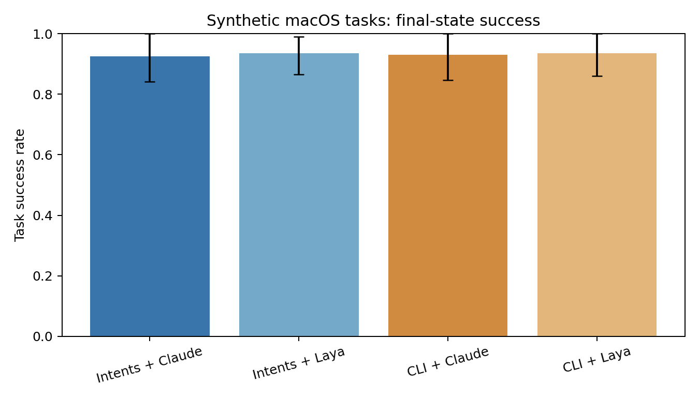
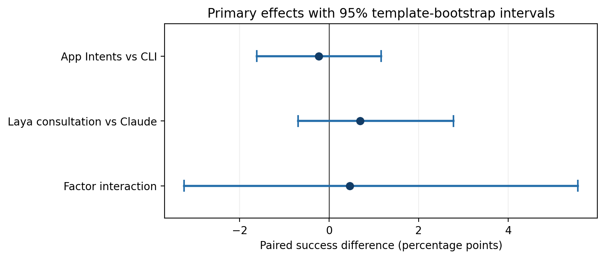
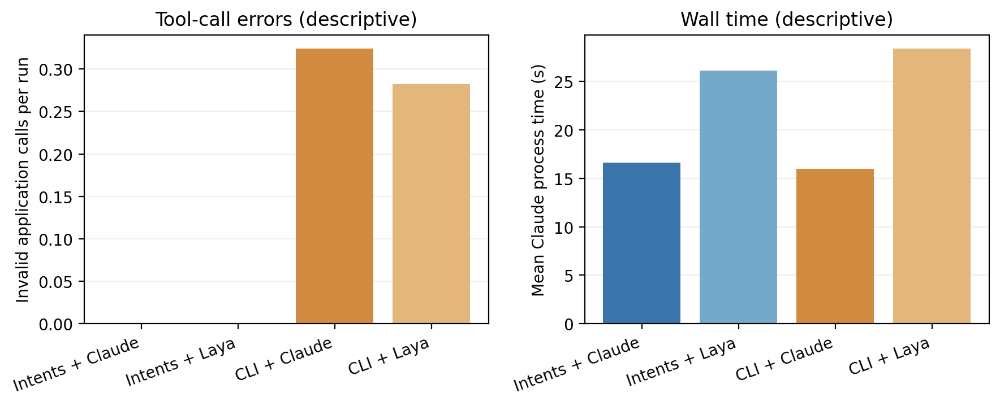

# Can Native App Intents Improve a CLI Agent's Reliability on macOS? A Paired Study with a Local Decision Model

**Working draft, 27 September 2026. The 864-run held-out experiment is complete. This manuscript requires further benchmark revision before submission.**

## Abstract

Language-model agents increasingly operate applications through programmatic tools, but the effect of a native operating-system action interface on task reliability remains unclear. We conduct a paired study of Apple App Intents and a command-line interface for the same synthetic macOS travel and task-management applications. Both interfaces use identical Swift business logic and resettable states. Claude Code, fixed to `doubao-seed-2.1-pro` through Volcano Ark Coding Plan, receives either seven App Intent tools executed through macOS Shortcuts or one command tool invoking `studyctl`. A second factor adds a local Laya next-action consultation. The corpus has 24 templates and 96 fixtures, with six templates for development and 18 for testing. We ran all four conditions three times on each of 72 held-out fixtures (864 runs). Exact-state success was 200/216 for App Intents + Claude, 202/216 for App Intents + Laya consultation, 201/216 for CLI + Claude, and 202/216 for CLI + Laya consultation. The paired interface difference was −0.23 percentage points (95% template-bootstrap interval −1.62 to +1.16), providing no detectable task-success advantage. The CLI conditions had 131 invalid application calls versus none in the App Intents conditions, yet 113 of 114 runs with such calls recovered. Laya made 1,079 consultations but accepted no recommendations under its development-locked threshold, so this study cannot attribute any improvement to Laya's decisions. A post hoc audit found that 58 of 59 exact-state failures differed only in an optional task-to-trip link that the prompt left ambiguous; accepting either link choice yields 863/864 successes. This benchmark ambiguity and ceiling limit causal and practical conclusions. We release the synthetic fixtures, protocol, analysis code, and de-identified run metrics to support a stronger follow-up study.

## 1. Introduction

Computer-use studies often contrast graphical interfaces with scripts or APIs. Yet application actions on Apple platforms can also be exposed as [App Intents](https://developer.apple.com/documentation/appintents/app-intents): declared capabilities with parameters that the operating system makes available to Shortcuts. A coding agent usually reaches such actions through a tool bridge, whereas a conventional command-line interface asks it to construct an operation and arguments. It is plausible that explicit native actions improve grounded execution, although Shortcuts adds its own execution and permission layers.

We study two questions. **RQ1:** holding goals, initial states, underlying business logic, and final-state verifier constant, does an App Intents/Shortcuts tool surface change the probability that a Claude Code agent completes a macOS application task relative to a command tool? **RQ2:** does a local, confidence-gated Laya next-action selector change that outcome, and what happens when it is uncertain or confidently wrong? Our design evaluates both factors with a 2 × 2 comparison.

The contribution is a controlled implementation and repeatable protocol, including a strict system integration gate. The App Intents condition must actually execute through `shortcuts run` and macOS's App Intents system. A direct Swift `perform()` call would test only application logic and cannot answer RQ1.

## 2. Related Work

[iOSWorld](https://arxiv.org/abs/2606.09764) evaluates phone agents on interconnected native iOS apps and highlights the difficulty of multi-app tasks. Our setting differs by targeting macOS, programmatic app actions, and matched execution surfaces rather than screen perception or personalization. [GUI vs. CLI](https://arxiv.org/abs/2606.24551) demonstrates the value of matched goals, states, and verifiers when comparing interaction modes. Our contrast concerns App Intents versus a command interface, both operated by the same CLI agent. [The Scaffolding Matters More Than the Interface](https://arxiv.org/abs/2608.08654) cautions that differences attributed to MCP or CLI can instead reflect agent scaffolding; our protocol fixes Claude Code and its model across conditions.

[MacArena](https://arxiv.org/abs/2606.06560) benchmarks GUI agents on 421 macOS tasks across 50 applications using Apple Silicon virtualization. [MacAgentBench](https://arxiv.org/abs/2606.22557) evaluates 676 macOS tasks across 25 applications, many involving both GUI and CLI interaction, and scores partial progress. These studies establish realistic macOS task distributions. Our smaller synthetic setting is designed for a controlled comparison of native App Intents/Shortcuts actions with a matched command-line surface and exact final-state grading; it cannot substitute for their breadth or ecological validity.

[ShortcutsBench](https://arxiv.org/abs/2407.00132) evaluates API selection, parameter filling, and user or system input requests from real Apple Shortcuts action sequences. It is the closest Apple action-interface precedent. Our study adds execution through installed macOS App Intents, resettable application state, and a paired comparison with a CLI path for the same service, while using far fewer tasks and applications.

[Laya](https://huggingface.co/convaiinnovations/laya) is a non-autoregressive decision model that answers typed choice questions and reports confidence. Its model card explicitly notes that fine-tuning on application-specific decisions can substantially improve accuracy. We evaluate the locally available multilingual checkpoint without domain fine-tuning, so this experiment concerns zero-shot transfer to sequential app actions. We do not equate its confidence on our domain with a calibrated probability until the development data support such a claim. Official [Apple platform guidance](https://developer.apple.com/design/human-interface-guidelines/app-shortcuts) distinguishes App Intents actions usable in macOS Shortcuts from App Shortcuts, which are not supported on macOS; our implementation uses custom shortcuts containing App Intent actions.

## 3. Experimental System

### 3.1 Applications and shared logic

Study Trips stores synthetic travel records with an identifier, destination, date, and status. Study Tasks stores synthetic to-dos with an identifier, title, due date, status, and optional trip link. Seven operations cover lookup, creation, status changes, and rescheduling. Each App Intent and the `studyctl` executable calls the same `StudyService` functions over the same JSON state files. Exact state files can be reset between trials. This design prevents divergent application logic from explaining differences between interfaces.

### 3.2 Execution surfaces

In the App Intents condition, seven MCP tools carry named string arguments. The bridge serializes their arguments to a temporary JSON input, calls a custom macOS Shortcut with `shortcuts run`, and reads its output. Each custom Shortcut maps JSON fields into its App Intent's parameters. In the command condition, a single MCP tool accepts `studyctl OPERATION JSON_ARGUMENTS`; the bridge parses it without a shell and invokes the Swift CLI. The two surfaces intentionally differ in what the agent must specify while operating the same service. Shortcuts' runtime cost and signing/permission behavior are part of the measured surface.

### 3.3 Agent and decision gate

The planner is Claude Code CLI, version-locked at experiment time, configured in the experiment process only for Volcano Ark's Anthropic-compatible Coding Plan endpoint and model `doubao-seed-2.1-pro`. Global user configuration is excluded. The Laya conditions add a `recommend_action` tool. It receives the task, current synthetic app state, prior actions, and candidate operations. If its answer confidence meets a threshold locked using development fixtures, the bridge requires that operation next. Otherwise Claude plans the next operation. Jev could later implement the same `choose(task, state, history)` interface, but it is not part of this first study.

### 3.4 Corpus and outcome

Six workflow families each have four language templates. Every template has four deterministic fixtures, producing 96 tasks. One complete template per family belongs to development (24 tasks); the other three complete templates per family are held-out tests (72 tasks). Workflows include lookup followed by linked creation, coordinated cancellation and completion, rescheduling, new trip and task creation, task completion, and conditional trip cancellation. Each fixture contains same-destination trips and same-title tasks. Agents must use a trip start date and task-to-trip association to identify the requested record. Conditional tasks include both booked and already-cancelled target trips. For each test task, all four conditions receive the same initial state and are repeated three times.

Each fixture includes an authored ideal action trajectory. Before agent trials, all 96 trajectories were executed through the shared Swift CLI and independently graded against their expected final states. This check found no corpus–verifier disagreement after normalizing Swift's omitted `nil` optional fields to JSON `null` in the scorer. The ideal trajectories are never included in the agent prompt.

The primary outcome is exact equality of the full final trips/tasks state with a precomputed expected state. Secondary outcomes include invalid tool calls, modifications beyond the requested changes, recovery after failure, tool calls, model token use, and tool and total latency. The verifier reads application state independently of agent messages.

## 4. Analysis Plan

The pre-specified analysis estimated the paired success-rate difference for the interface factor, the decision-gate factor, and their interaction. Each test fixture and repetition formed a four-arm matched unit. Ninety-five percent intervals used 5,000 percentile bootstrap resamples of the 18 held-out templates; all fixture variants and repetitions for a template remained together in each resample. We report per-arm success and secondary outcomes, along with unsuccessful and timed-out runs. This clustering acknowledges shared wording and task structure within templates. It does not support claims beyond the synthetic task population.

Before test runs, the runner locked macOS, Xcode, Claude Code, Laya package and checkpoint revision, model identifier, Coding Plan base URL, and hashes of the corpus, calibration, and implementation. Arm order within each task repetition was deterministically shuffled. The threshold and prompt protocol were fixed from development data alone and were not revised after test outcomes became available.

The observed environment was macOS 27.2, Xcode 27.0 (build 27A266a), Claude Code 2.1.250, Laya 0.3.20 with checkpoint revision `55cf4c4ebb4ebe31b2550e8bdf3bd21b99753851`, and `doubao-seed-2.1-pro` through Volcano Ark Coding Plan. Exact corpus, calibration, and implementation hashes are in `data/version_lock.json`.

## 5. Results

Both apps compile, pass strict signature verification with an Apple Development identity, and are installed locally. The initial ad-hoc build failed with `linkd` reporting `requiresValidatedBundle`. After signing, `shortcuts run AI_search_trips` returned the expected Kyoto trip from the reset fixture, and `shortcuts run AI_create_task` returned a created task whose ID appeared in the final application state. All seven wrappers now pass a real Shortcuts execution gate, including final-state checks for creation, status changes, and rescheduling. The revised development split yielded 22/24 exact-state successes for Intents + Claude, 24/24 for Intents + Laya consultation, 24/24 for CLI + Claude, and 22/24 for CLI + Laya consultation. The four failures were extra changes on conditional tasks. These development observations are not estimates of held-out effects. The previous easier corpus produced 65 successful runs in 65 attempts across five development templates; these pilot observations are excluded from the revised protocol and its analysis. A pure Text shortcut initially hung through the Shortcuts CLI but succeeded with an explicit **Stop and Output** action.

The local multilingual Laya endpoint successfully returned decisions when explicitly asked for the multilingual checkpoint. On 68 ideal steps from the revised template-isolated development split, it chose the prescribed next operation 18 times. Several wrong choices had confidence 1.0. Under the declared conservative rule of maximizing accepted development decisions while accepting no observed wrong choice, the threshold is 1.01 and accepts zero suggestions. A previous exploratory calibration using fixture-level splitting is excluded from this result. In the held-out runs, Laya was consulted 1,079 times and zero recommendations crossed the threshold. The direct decision gate therefore never constrained an application action. The Laya arms still changed the prompt and added consultation calls; their observed differences measure this consultation workflow, not better decisions by Laya.

*Figure 1. Correct and wrong ideal-trajectory decisions accepted at each reported-confidence threshold. Only development tasks contribute to this figure.*

### 5.1 Primary outcome

All 864 held-out runs produced a final application-state snapshot, giving 216 complete task-by-repetition pairs across the four arms. An independent second pass reproduced the stored exact-state scores for all 864 snapshots. One App Intents + Claude process reached the 180-second limit after making the correct state change; it counts as a state success and is separately marked as an execution timeout. There were no other process failures.

| Interface | Decision workflow | Exact-state successes / 216 | Success rate | 95% template-bootstrap interval |
| --- | --- | ---: | ---: | ---: |
| App Intents | Claude | 200 | 92.59% | 84.26–100.00% |
| App Intents | Laya consultation | 202 | 93.52% | 86.57–99.07% |
| CLI | Claude | 201 | 93.06% | 84.72–100.00% |
| CLI | Laya consultation | 202 | 93.52% | 86.11–100.00% |

The paired App Intents-minus-CLI difference, averaged across decision workflows, is **−0.23 percentage points** (95% interval **−1.62 to +1.16**). The consultation-minus-Claude difference is **+0.69 points** (−0.69 to +2.78), and the factor interaction is **+0.46 points** (−3.24 to +5.56). All intervals include zero. These are uncertainty intervals for this synthetic template population; they do not establish equivalence or generalize to production applications.

*Figure 2. Per-arm exact-state success with 95% bootstrap intervals clustered by the 18 held-out templates.*

*Figure 3. Paired main effects and interaction. Zero indicates no difference under the pre-specified exact-state score.*

### 5.2 Invalid calls, recovery, and cost

No App Intents application action failed in 432 runs. The two CLI arms generated 70 and 61 invalid application calls, respectively. Across both CLI arms, 103 were rejected task-status values (`completed` 97, `closed` 4, `finished` 2, where the service requires `done`); 28 were malformed command or JSON invocations. Invalid calls occurred in 114 runs, 113 of which nonetheless reached the exact expected state after recovery. Thus we observed fewer call errors on the typed action surface without a detectable task-success gain in this corpus. The comparison changes MCP tool presentation as well as the system execution path, so the error difference cannot be isolated to Apple's native parameter types.

App Intents application actions averaged about 1.36–1.39 seconds per run versus 0.053 seconds for CLI actions, reflecting the measured Shortcuts execution path. Mean full Claude-process wall time was 16.60 seconds for App Intents + Claude, 15.98 for CLI + Claude, 26.10 for App Intents + Laya consultation, and 28.39 for CLI + Laya consultation. The local Laya calls themselves averaged 1.72 seconds per Laya-arm run; the larger total difference also includes extra prompt and model work. These latency comparisons are descriptive, not a controlled estimate of only the local model's execution time. Token-use summaries and all run-level timings are included in the released machine-readable analysis and data.

*Figure 4. Descriptive secondary outcomes; the panels do not show uncertainty intervals.*

### 5.3 Post hoc verifier sensitivity

Only one of the 59 exact-state failures was a missed requested due-date update. The other 58 differed solely because the agent linked a new follow-up task to the target trip, whereas the authored expected state left its optional trip link empty. The prompt requested a follow-up task for that trip but did not say whether it should be linked. In a clearly labeled **post hoc sensitivity analysis**, accepting either no link or a link to the correct target trip changes the success counts to 216/216, 215/216, 216/216, and 216/216 in the table's order: 863/864 runs overall. We retain the original exact-state score as the primary result, but the sensitivity analysis shows that its failures are dominated by an underspecified annotation choice. The remaining failure was one App Intents + Laya run that found the target task but did not update its due date. A new corpus must resolve this ambiguity prospectively and include harder, diverse tasks before using these results to argue for a reliable task-completion benefit.

## 6. Limitations

The benchmark uses two small synthetic apps on one Mac, so external validity to production apps, personal data, and other macOS versions is limited. Most task families were at or near a success ceiling; the conditional family was dominated by the optional-link ambiguity. The interface contrast changes both schema exposure and runtime path; it cannot isolate which App Intents feature causes an effect. The CLI condition uses a command tool within MCP to hold the planner and high-level tool channel constant. A zero-shot Laya model trained for general typed decisions may not transfer to temporal tool planning; its confidence can be miscalibrated under this shift. With the present development-locked threshold, Laya never constrains an action, so the held-out difference between decision arms measures consultation and prompting effects, not a benefit from Laya's selected actions. RQ2 therefore cannot establish an improvement from Laya under this protocol. Sequential task execution on one machine prevents independent parallel runs and may leave system caches warm; arm order was shuffled deterministically within each task repetition, but hardware and service drift across the long run remain possible. Development signing and Shortcuts permissions are genuine parts of the macOS path but may also create machine-specific failure modes.

## 7. Conclusion and Next Experiment

The true macOS Shortcuts-to-App-Intents path ran reliably, and its tool surface had zero observed invalid application calls compared with 131 in the command condition. Exact-state task success differed by less than one percentage point between any two arms, with intervals spanning zero. Because an ambiguous optional link accounts for almost every exact-state failure, this study is best viewed as an integration and measurement result. The next experiment should explicitly specify link semantics, recruit more apps and action types, and include tasks where failed calls have downstream consequences. Laya needs an app-action-specific calibration or training procedure evaluated on a new held-out split; this test set should not be reused to tune it.

## References

1. Apple. [App Intents documentation](https://developer.apple.com/documentation/appintents/app-intents).
2. Apple. [App Shortcuts platform guidance](https://developer.apple.com/design/human-interface-guidelines/app-shortcuts).
3. Jang et al. [iOSWorld: A Benchmark for Personally Intelligent Phone Agents](https://arxiv.org/abs/2606.09764), 2026.
4. Zhou et al. [GUI vs. CLI: Execution Bottlenecks in Screen-Only and Skill-Mediated Computer-Use Agents](https://arxiv.org/abs/2606.24551), 2026.
5. [The Scaffolding Matters More Than the Interface](https://arxiv.org/abs/2608.08654), 2026.
6. ConvAI Innovations. [Laya model card](https://huggingface.co/convaiinnovations/laya).
7. Muryn et al. [MacArena: Benchmarking Computer Use Agents on an Online macOS Environment](https://arxiv.org/abs/2606.06560), 2026.
8. Fu et al. [MacAgentBench: Benchmarking AI Agents on Real-World macOS Desktop](https://arxiv.org/abs/2606.22557), 2026.
9. Shen et al. [ShortcutsBench: A Large-Scale Real-world Benchmark for API-based Agents](https://arxiv.org/abs/2407.00132), ICLR 2025.
