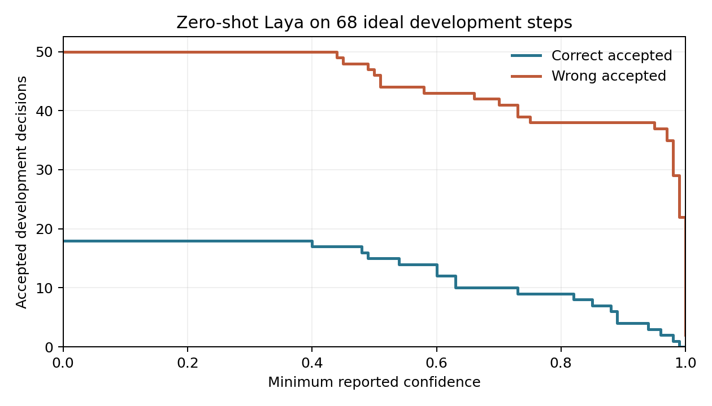

# Can Native App Intents Improve a CLI Agent's Reliability on macOS? A Paired Study with a Local Decision Model

**Working draft, 27 September 2026. All seven Shortcuts integration checks have passed; held-out agent results remain unfilled.**

## Abstract

Language-model agents increasingly operate applications through programmatic tools, but the effect of a native operating-system action interface on task reliability remains unclear. We design a paired study of Apple App Intents and a command-line interface for the same synthetic macOS travel and task-management applications. Both interfaces use identical Swift business logic and start from identical resettable states. Claude Code, fixed to `doubao-seed-2.1-pro` through Volcano Ark Coding Plan, receives either seven typed App Intent tools executed through macOS Shortcuts or one command tool that invokes `studyctl`. A second factor adds a local Laya decision gate that proposes the next action and delegates to Claude when its development-set confidence threshold is not met. The corpus contains 24 templates and 96 fixtures: six complete templates (24 tasks) for development and 18 complete templates (72 tasks) for testing. We plan three paired repetitions of every test fixture in all four conditions and evaluate exact final application state, unexpected changes, invalid calls, recovery, tool use, model use, and latency. After replacing the initial ad-hoc build with Apple Development signed apps, the real Shortcuts read/write gate passed. The revised corpus completed 96 development-arm runs, with 92 exact-state successes and four extra-change failures; held-out analysis is pending. An easier preliminary corpus produced 65/65 successful pilot runs, motivating a prospective difficulty revision before any held-out run. This draft reports experimental design and feasibility evidence without inventing a held-out task-success result.

## 1. Introduction

Computer-use studies often contrast graphical interfaces with scripts or APIs. Yet application actions on Apple platforms can also be exposed as [App Intents](https://developer.apple.com/documentation/appintents/app-intents): declared capabilities with parameters that the operating system makes available to Shortcuts. A coding agent usually reaches such actions through a tool bridge, whereas a conventional command-line interface asks it to construct an operation and arguments. It is plausible that explicit native actions improve grounded execution, although Shortcuts adds its own execution and permission layers.

We study two questions. **RQ1:** holding goals, initial states, underlying business logic, and final-state verifier constant, does an App Intents/Shortcuts tool surface change the probability that a Claude Code agent completes a macOS application task relative to a command tool? **RQ2:** does a local, confidence-gated Laya next-action selector change that outcome, and what happens when it is uncertain or confidently wrong? Our design evaluates both factors with a 2 × 2 comparison.

The contribution is a controlled implementation and repeatable protocol, including a strict system integration gate. The App Intents condition must actually execute through `shortcuts run` and macOS's App Intents system. A direct Swift `perform()` call would test only application logic and cannot answer RQ1.

## 2. Related Work

[iOSWorld](https://arxiv.org/abs/2606.09764) evaluates phone agents on interconnected native iOS apps and highlights the difficulty of multi-app tasks. Our setting differs by targeting macOS, programmatic app actions, and matched execution surfaces rather than screen perception or personalization. [GUI vs. CLI](https://arxiv.org/abs/2606.24551) demonstrates the value of matched goals, states, and verifiers when comparing interaction modes. Our contrast concerns App Intents versus a command interface, both operated by the same CLI agent. [The Scaffolding Matters More Than the Interface](https://arxiv.org/abs/2608.08654) cautions that differences attributed to MCP or CLI can instead reflect agent scaffolding; our protocol fixes Claude Code and its model across conditions.

[Laya](https://huggingface.co/convaiinnovations/laya) is a non-autoregressive decision model that answers typed choice questions and reports confidence. Its model card explicitly notes that fine-tuning on application-specific decisions can substantially improve accuracy. We evaluate the locally available multilingual checkpoint without domain fine-tuning, so this experiment concerns zero-shot transfer to sequential app actions. We do not equate its confidence on our domain with a calibrated probability until the development data support such a claim. Official [Apple platform guidance](https://developer.apple.com/design/human-interface-guidelines/app-shortcuts) distinguishes App Intents actions usable in macOS Shortcuts from App Shortcuts, which are not supported on macOS; our implementation uses custom shortcuts containing App Intent actions.

## 3. Experimental System

### 3.1 Applications and shared logic

Study Trips stores synthetic travel records with an identifier, destination, date, and status. Study Tasks stores synthetic to-dos with an identifier, title, due date, status, and optional trip link. Seven operations cover lookup, creation, status changes, and rescheduling. Each App Intent and the `studyctl` executable calls the same `StudyService` functions over the same JSON state files. Exact state files can be reset between trials. This design prevents divergent application logic from explaining differences between interfaces.

### 3.2 Execution surfaces

In the App Intents condition, seven MCP tools carry named string arguments. The bridge serializes their arguments to a temporary JSON input, calls a custom macOS Shortcut with `shortcuts run`, and reads its output. Each custom Shortcut maps JSON fields into its App Intent's parameters. In the command condition, a single MCP tool accepts `studyctl OPERATION JSON_ARGUMENTS`; the bridge parses it without a shell and invokes the Swift CLI. The two surfaces intentionally differ in what the agent must specify while operating the same service. Shortcuts' runtime cost and signing/permission behavior are part of the measured surface.

### 3.3 Agent and decision gate

The planner is Claude Code CLI, version-locked at experiment time, configured in the experiment process only for Volcano Ark's Anthropic-compatible Coding Plan endpoint and model `doubao-seed-2.1-pro`. Global user configuration is excluded. The Laya conditions add a `recommend_action` tool. It receives the task, current synthetic app state, prior actions, and candidate operations. If its answer confidence meets a threshold locked using development fixtures, the bridge requires that operation next. Otherwise Claude plans the next operation. Jev could later implement the same `choose(task, state, history)` interface, but it is not part of this first study.

### 3.4 Corpus and outcome

Six workflow families each have four language templates. Every template has four deterministic fixtures, producing 96 tasks. One complete template per family belongs to development (24 tasks); the other three complete templates per family are held-out tests (72 tasks). Workflows include lookup followed by linked creation, coordinated cancellation and completion, rescheduling, new trip and task creation, task completion, and conditional trip cancellation. Each fixture contains same-destination trips and same-title tasks. Agents must use a trip start date and task-to-trip association to identify the requested record. Conditional tasks include both booked and already-cancelled target trips. For each test task, all four conditions receive the same initial state and are repeated three times.

Each fixture includes an authored ideal action trajectory. Before agent trials, all 96 trajectories were executed through the shared Swift CLI and independently graded against their expected final states. This check found no corpus–verifier disagreement after normalizing Swift's omitted `nil` optional fields to JSON `null` in the scorer. The ideal trajectories are never included in the agent prompt.

The primary outcome is exact equality of the full final trips/tasks state with a precomputed expected state. Secondary outcomes include invalid tool calls, modifications beyond the requested changes, recovery after failure, tool calls, model token use, and tool and total latency. The verifier reads application state independently of agent messages.

## 4. Analysis Plan

We will estimate the paired success-rate difference for the interface factor, the decision-gate factor, and their interaction. Each test fixture and repetition forms a four-arm matched unit. Ninety-five percent intervals will use 5,000 percentile bootstrap resamples of the 18 held-out templates; all fixture variants and repetitions for a template remain together in each resample. We will report per-arm success and secondary outcomes, along with unsuccessful and timed-out runs. This clustering acknowledges shared wording and task structure within templates. It does not support claims beyond the synthetic task population.

Before test runs, the runner locks macOS, Xcode, Claude Code, Laya package and checkpoint revision, model identifier, Coding Plan base URL, and hashes of the corpus, calibration, and implementation. Arm order within each task repetition is deterministically shuffled. The threshold and prompt protocol are fixed from development data alone. We will not revise them after seeing test outcomes.

## 5. Feasibility Observations and Results Pending

Both apps compile, pass strict signature verification with an Apple Development identity, and are installed locally. The initial ad-hoc build failed with `linkd` reporting `requiresValidatedBundle`. After signing, `shortcuts run AI_search_trips` returned the expected Kyoto trip from the reset fixture, and `shortcuts run AI_create_task` returned a created task whose ID appeared in the final application state. All seven wrappers now pass a real Shortcuts execution gate, including final-state checks for creation, status changes, and rescheduling. The revised development split yielded 22/24 exact-state successes for Intents + Claude, 24/24 for Intents + Laya consultation, 24/24 for CLI + Claude, and 22/24 for CLI + Laya consultation. The four failures were extra changes on conditional tasks. These development observations are not estimates of held-out effects. The previous easier corpus produced 65 successful runs in 65 attempts across five development templates; these pilot observations are excluded from the revised protocol and its analysis. A pure Text shortcut initially hung through the Shortcuts CLI but succeeded with an explicit **Stop and Output** action.

The local multilingual Laya endpoint successfully returned decisions when explicitly asked for the multilingual checkpoint. On 68 ideal steps from the revised template-isolated development split, it chose the prescribed next operation 18 times. Several wrong choices had confidence 1.0. Under the declared conservative rule of maximizing accepted development decisions while accepting no observed wrong choice, the threshold is 1.01 and accepts zero suggestions. This makes the Laya intervention inactive in the current zero-shot protocol. A previous exploratory calibration using fixture-level splitting is excluded from this result. Any attempt to improve Laya through fine-tuning or a different decision schema would require a new development process and an untouched evaluation split; results from that later protocol must be labeled separately.

*Figure 1. Correct and wrong ideal-trajectory decisions accepted at each reported-confidence threshold. Only development tasks contribute to this figure.*

**Insert only after all 864 test runs:** four-arm success table; paired effect estimates and intervals; chart; error and latency analyses; interpretation of any apparent interface effect.

## 6. Limitations

The benchmark uses two small synthetic apps on one Mac, so external validity to production apps, personal data, and other macOS versions is limited. The interface contrast changes both schema exposure and runtime path; it cannot isolate which App Intents feature causes an effect. The CLI condition uses a command tool within MCP to hold the planner and high-level tool channel constant. A zero-shot Laya model trained for general typed decisions may not transfer to temporal tool planning; its confidence can be miscalibrated under this shift. With the present development-locked threshold, Laya never constrains an action, so any held-out difference between the two decision arms would measure the cost or prompting effect of consultation rather than a benefit from Laya's selected actions. RQ2 therefore cannot establish an improvement from Laya under this protocol. Sequential task execution on one machine prevents independent parallel runs and may leave system caches warm; ordering and resets must be reported. Development signing and Shortcuts permissions are genuine parts of the macOS path but may also create machine-specific failure modes.

## References

1. Apple. [App Intents documentation](https://developer.apple.com/documentation/appintents/app-intents).
2. Apple. [App Shortcuts platform guidance](https://developer.apple.com/design/human-interface-guidelines/app-shortcuts).
3. Jang et al. [iOSWorld: A Benchmark for Personally Intelligent Phone Agents](https://arxiv.org/abs/2606.09764), 2026.
4. Zhou et al. [GUI vs. CLI: Execution Bottlenecks in Screen-Only and Skill-Mediated Computer-Use Agents](https://arxiv.org/abs/2606.24551), 2026.
5. [The Scaffolding Matters More Than the Interface](https://arxiv.org/abs/2608.08654), 2026.
6. ConvAI Innovations. [Laya model card](https://huggingface.co/convaiinnovations/laya).
